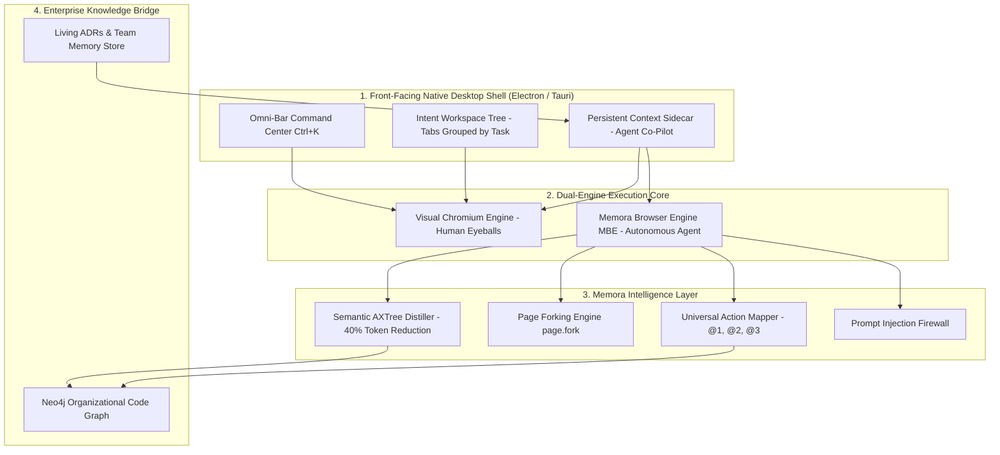
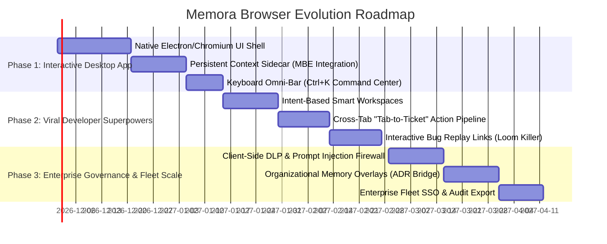

# 🌐 MEMORA BROWSER: ENTERPRISE & VIRAL WORK OS BLUEPRINT
## From Headless Agent Engine (Orbis) to The Autonomous, Viral Work Browser

* **Document Version:** 1.0.0-ENTERPRISE-VIRAL  
* **Target Scope:** `memora-browser` (MBE Core + Autonomous Interactive Shell)  
* **Target Audience:** Founders, Product Leads, Senior Staff Engineers, Enterprise Buyers (CTO/CISO)  
* **Core Value Proposition:** *"The Work Browser That Thinks, Remembers, and Acts."*  

---

## 1. Executive Vision: Why Modern Browsers Are Broken

### The Tab Graveyard & The Copy-Paste Tax
Traditional web browsers (Chrome, Edge, Safari, Brave) were engineered in the 2000s for a fundamentally different era: **human eyeballs reading static documents**.

Today, knowledge workers, software engineers, and product teams use browsers as their primary operating system. Yet:
1. **Context Fragmentation (Tab Graveyard):** The average engineer has 60–100 tabs open across GitHub PRs, Jira tickets, Datadog alerts, Figma boards, AWS consoles, and Google Docs. Tabs are flat, dumb lists of URLs with zero semantic awareness of tasks or projects.
2. **The "Copy-Paste Monkey" Tax:** Up to 40% of knowledge work consists of manually copying text from one tab (e.g. Datadog error log), pasting it into a second tab (GitHub search), summarizing it in a third (Jira ticket), and pinging a team in a fourth (Slack).
3. **The Failure of First-Gen "AI Browsers":**
   * **Arc Browser:** Innovated on visual styling (spaces, sidebar), but remained a passive display shell with a superficial chatbot stuck on the side.
   * **Enterprise Security Browsers (Island, Talon):** Built as restrictive security cages that lock down developer freedom, causing high friction and developer resentment.

### The Memora Browser Thesis
Memora Browser leverages our existing **Memora Browser Engine (MBE / Orbis)**—which is already 11x lighter and 11x faster than headless Chromium with semantic AXTree distillation and universal action IDs—to build:
> **The world's first Autonomous Work Browser that unifies navigation, organizational memory, and agentic execution into a single, viral desktop application.**

---

## 2. The 5 Real-World Pain Points & Memora's Solution Matrix

```
┌─────────────────────────────────┬─────────────────────────────────┬─────────────────────────────────┐
│     USER PAIN POINT             │   WHY TRADITIONAL BROWSERS FAIL │    MEMORA BROWSER SOLUTION     │
├─────────────────────────────────┼─────────────────────────────────┼─────────────────────────────────┤
│ 1. Tab Overload & Context       │ Tabs are treated as isolated    │ Intent-Based Smart Workspaces   │
│    Amnesia (60+ tabs open)      │ URLs. Mental context is lost.   │ & Project Memory Trees          │
├─────────────────────────────────┼─────────────────────────────────┼─────────────────────────────────┤
│ 2. Cross-App Copy-Paste Tax     │ No cross-tab action pipeline;   │ Universal Semantic Clip &       │
│    (Jira <-> GitHub <-> Logs)   │ repetitive manual data transfer.│ 1-Click Action Flow             │
├─────────────────────────────────┼─────────────────────────────────┼─────────────────────────────────┤
│ 3. Repetitive Form Grunt Work   │ Users fill the same SaaS forms  │ Autonomous Multi-Step Action    │
│    (Procurement, Expenses)      │ manually week after week.       │ Loop (Form Filler Engine)       │
├─────────────────────────────────┼─────────────────────────────────┼─────────────────────────────────┤
│ 4. Ephemeral Bug Reproduction   │ Broken checkouts or staging bugs│ 1-Click Page Forking & Live     │
│    is impossible to share       │ captured as flat screenshots.   │ Replay Snapshots (Loom Killer)  │
├─────────────────────────────────┼─────────────────────────────────┼─────────────────────────────────┤
│ 5. Enterprise Data Leakage      │ Employees paste confidential    │ Client-Side DLP & Zero-Trust    │
│    & Shadow AI Risks            │ code & PII into consumer LLMs.  │ Prompt Injection Firewall       │
└─────────────────────────────────┴─────────────────────────────────┴─────────────────────────────────┘
```

---

## 3. Product Architecture: Dual-Core Browser Design

Memora Browser bridges high-speed visual human rendering with ultra-fast autonomous agent execution:



### Core Architecture Components:

#### 1. Visual Human Renderer (Web-Facing)
* Native Chromium webview providing 100% web compatibility (all extensions, CSS, WebGL, cookies, and logins work out of the box).
* Keyboard-driven command center (`Cmd+K` / `Ctrl+K`).

#### 2. Headless Agent Execution Core (`memora-browser/src/`)
* Reuses the existing **Memora Browser Engine**:
  * Semantic accessibility tree distillation (`src/engine/axtree.ts`) providing token-efficient page representations.
  * Universal Action IDs (`[@1]`, `[@2]`, `[@3]`) allowing LLMs to click, type, and select without pixel coordinate guesswork.
  * Instant sub-5ms page cloning via `page.fork()`.
  * Zero-network sandbox mode for risk-free automated dry runs.

#### 3. Organizational Knowledge Bridge
* Deeply connected to the **Memora Backend**:
  * When browsing GitHub PRs, automatically displays verified downstream blast radius from Neo4j.
  * When reading Jira tickets, shows relevant team ADRs and past Google Meet decisions.

---

## 4. The 4 Viral Growth Drivers (Bottom-Up Developer & Knowledge Worker Adoption)

To build a **viral enterprise browser** (following the playbook of Slack, Figma, Notion, and Cursor), adoption must start with individual developers loving a magic superpower and inviting their squads.

```
       ┌─────────────────────────────────────────────────────────────┐
       │                   THE 4 VIRAL SUPERPOWERS                   │
       └─────────────────────────────────────────────────────────────┘
                                      │
         ┌────────────────────────────┼────────────────────────────┐
         ▼                            ▼                            ▼
┌──────────────────┐        ┌──────────────────┐        ┌──────────────────┐
│   SUPERPOWER 1   │        │   SUPERPOWER 2   │        │   SUPERPOWER 3   │
│ Tab-to-Ticket in │        │ 1-Click Live Bug │        │ Live Page Fork   │
│    5 Seconds     │        │ Replay (Loom X)  │        │ Experimentation  │
│                  │        │                  │        │                  │
│ Highlight log on │        │ Record live DOM  │        │ page.fork() cart │
│ Datadog -> Jira  │        │ replay link for  │        │ to test 3 states │
│ auto-filed + PR  │        │ squad debugging  │        │ simultaneously   │
└──────────────────┘        └──────────────────┘        └──────────────────┘
```

---

### Superpower 1: "Tab-to-Ticket" in 5 Seconds (Cross-App Automation)
* **The Problem:** Engineer sees an error in Datadog / CloudWatch. They spend 5 minutes copying stack traces, finding the repository, opening Jira, creating a ticket, and pinging Slack.
* **The Memora Magic:**
  1. Engineer highlights the error log in Datadog.
  2. Hits `Ctrl+Space` (Memora Action Bar).
  3. Types: *"File Jira bug and link affected service"*
  4. **The Agent executes in the background:**
     * Connects to GitHub, traces the owning squad from the code graph.
     * Fills the Jira form with formatted traceback, link to Datadog timestamp, and affected service tag.
     * Posts the ticket link to the squad Slack channel.
  * **Viral Hook:** *"Shared via Memora Work Browser"* link at the bottom of the Jira ticket. Teammates click it to inspect the live session.

---

### Superpower 2: Interactive Live Bug Replay (The "Loom Killer" for Devs)
* **The Problem:** Developers record 3-minute Loom videos showing UI bugs. The receiving backend engineer still cannot inspect network headers, console errors, or DOM state.
* **The Memora Magic:**
  1. Developer encounters a bug on a staging environment or web app.
  2. Clicks **"Capture Interactive Bug Snapshot"**.
  3. Memora captures the exact DOM state, storage, cookies, and network HAR in a tamper-evident snapshot.
  4. Generates a secure share link: `memora.replay/snp_8f29c`.
  5. The receiving engineer clicks the link and opens an **interactive, inspectable sandbox tab** where they can open Chrome DevTools, inspect network traffic, and reproduce the bug with 1 click.
  * **Viral Hook:** Every bug report sent across squads exposes 5–10 other engineers to Memora Browser.

---

### Superpower 3: Instant Page Forking (`page.fork()`)
* **The Problem:** In complex e-commerce, banking, or multi-step configuration flows, testing alternative paths requires starting the checkout or form from step 1 all over again.
* **The Memora Magic:**
  * Developer or tester clicks `Alt+F` (**Fork Tab**).
  * In **5ms**, Memora clones the running page state (DOM, cookies, local storage, session storage) into a parallel tab without making a new network round-trip.
  * Now the user can test Option A in Tab 1 and Option B in Tab 2 simultaneously.

---

### Superpower 4: Ghost Form Filler (Automating Enterprise SaaS Drudgery)
* **The Problem:** Enterprise employees spend hours filling Workday expenses, Coupa procurement requests, and Salesforce CRM fields.
* **The Memora Magic:**
  * User pastes an email or invoice PDF into the sidecar.
  * Says: *"Fill this expense report in Workday."*
  * Memora's MBE form-filling engine identifies textboxes, radio buttons, dropdowns, and datepickers, filling the entire 4-page wizard in **3 seconds** with visual verification highlights.

---

## 5. Enterprise Moat & Monetization ($50k–$250k Annual Contracts)

Enterprises will gladly mandate Memora Browser across 5,000 employees for three critical reasons:

### 1. Zero-Trust Client-Side Prompt Injection & DLP Firewall
* Developers frequently copy proprietary code, customer PII, and API keys into web LLMs (ChatGPT, Claude, Perplexity).
* **Memora's Defense:** Reuses `memora-browser/PROMPT_INJECTION_FIREWALL.md`:
  * Real-time regex and token sanitization scrubs secret tokens (`sk-...`, `ghp_...`, AWS keys) and PII (SSNs, credit cards) before text is dispatched to external web servers.
  * Scans web pages for hidden prompt injection attacks (zero-width fonts, white-on-white text) before feeding page content to AI models.

### 2. Organizational Memory in Every Tab
* When a developer browses a GitHub Pull Request, Memora automatically injects an ambient overlay:
  * *"⚠️ Warning: This PR imports `BillingDatabase` directly, which violates active team policy ADR-048."*
* When reading an ambiguous Jira ticket:
  * *"💡 Context: In yesterday's Google Meet sprint sync, Sarah agreed this should be handled in Q1."*

### 3. Unified Audit & Compliance Logging
* Every automated action taken by the browser is logged to a cryptographic audit ledger (MongoDB / S3) proving who initiated the action, what data was accessed, and which policy was validated (SOC-2 Type II, ISO 27001, and HIPAA compliance).

---

## 6. Real-World Walkthrough: The Monday Morning Sev-1 Incident

Let's walk through how Memora Browser transforms a high-stress production outage:

```
[09:15 AM: Alert in Datadog]
  │
  ├─ User opens Datadog tab in Memora Browser
  ├─ Highlight: "504 Gateway Timeout in /checkout"
  ├─ Hotkey: Ctrl+K -> "Triage Incident"
  │
[09:16 AM: Automated Dependency Blast Analysis]
  │
  ├─ Memora connects to Neo4j Code Graph in background
  ├─ Identifies: "PR #412 merged 20 minutes ago modified billing signature"
  ├─ Opens PR #412 in a split-screen Smart Workspace
  │
[09:17 AM: Verification & Sandbox Reproduction]
  │
  ├─ Sidecar Agent runs Ephemeral Sandbox reproducer
  ├─ Confirms Exit Code 1 downstream crash in order_service.py
  │
[09:18 AM: 1-Click Remediation & Communication]
  │
  ├─ Agent drafts Jira Sev-1 Incident Ticket with full trace & reproducer
  ├─ Opens 1-Click Rollback PR Branch on GitHub
  ├─ Pings Slack #incidents: "Incident identified. Rollback PR #413 ready for approval."
```

*Total elapsed time: **3 minutes**. Zero tab chaos, zero copy-pasting, zero lost context.*

---

## 7. Phased Implementation Roadmap for `memora-browser`



### Phase 1: The Native Desktop Shell & Sidecar (Months 1–2)
* Build the native desktop window wrapper (Electron / Tauri) hosting standard Chromium for user browsing.
* Wire the existing **Memora Browser Engine (`src/engine/browser.ts`)** into a persistent, collapsible right-sidecar panel.
* Add `Ctrl+K` Omni-Bar for instant natural language web automation.

### Phase 2: Viral Workspaces & Superpowers (Months 3–4)
* Implement **Intent Workspaces**: grouping tabs by project and task with persistent session memory.
* Launch **Tab-to-Ticket Action Pipeline**: 1-click cross-app data transfer between Datadog, GitHub, Jira, and Slack.
* Launch **Interactive Bug Replay Links**: shareable sandboxed DOM snapshots for zero-friction developer bug reporting.

### Phase 3: Enterprise Fleet & Compliance Moat (Months 5–6)
* Activate **Client-Side DLP & Prompt Injection Firewall**: preventing confidential code and PII leaks.
* Integrate **Living ADR Overlays**: projecting team decisions and architectural invariants directly onto GitHub and Jira tabs.
* Enterprise SOC-2 compliance audit logging and team management portal.

---

## 8. Summary: Why Memora Browser Wins

| Feature | Legacy Chrome / Edge | Arc Browser | Enterprise Security Browsers | **Memora Browser** |
| :--- | :---: | :---: | :---: | :---: |
| **Rendering Engine** | Heavy Pixel Renderer | Heavy Pixel Renderer | Heavy Virtualized Container | **Dual-Engine (Chromium + 11x Lighter MBE)** |
| **Tab Organization** | Flat URL lists | Aesthetic vertical tabs | Restricted admin tabs | **Intent-Based Project Memory Trees** |
| **Autonomous Action** | None (Extensions only) | Passive sidebar AI chat | None | **Universal Action IDs (`[@1]`, `[@2]`) & Form Filler** |
| **Instant State Cloning**| None (Full reload) | None | None | **Sub-5ms `page.fork()` Tab Cloning** |
| **Cross-App Automation**| Manual Copy-Paste | None | None | **1-Click "Tab-to-Ticket" Pipeline** |
| **Enterprise Memory** | Zero awareness | Zero awareness | URL whitelisting only | **Living ADR & Neo4j Code Graph Ingestion** |
| **Security & DLP** | None | None | Heavy restrictive cage | **Client-Side Secret Redaction & Anti-Injection** |

