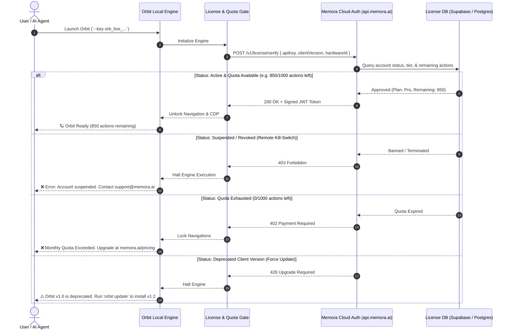

# 🪐 ORBIT BY MEMORA
### *The Web, Working for You.*
> **An Agentic Browser. Built for Autonomous Intelligence.**  
> *Explore. Understand. Execute.*

---

## 🏛️ 1. Brand Hierarchy & Product Naming Structure

The product ecosystem is organized into a clean, enterprise-grade brand hierarchy similar to Google / Chrome / Chromium or Apple / Safari / WebKit:

```
                            ┌────────────────────────────────────────┐
                            │           MEMORA (Parent)              │
                            │      Foundational AI Organization      │
                            └───────────────────┬────────────────────┘
                                                │
                                                ▼
                            ┌────────────────────────────────────────┐
                            │               MEMORA AI                │
                            │      Unified Agentic AI Platform       │
                            └───────────────────┬────────────────────┘
                                                │
                     ┌──────────────────────────┴──────────────────────────┐
                     ▼                                                     ▼
    ┌─────────────────────────────────┐                   ┌──────────────────────────────────┐
    │       ORBIT (The Browser)       │                   │    ORBIT AGENT (Autonomous)     │
    │  Next-Gen Agentic Web Interface │                   │ Built-in Autonomous Task Runner  │
    └────────────────┬────────────────┘                   └──────────────────────────────────┘
                     │
                     ▼
    ┌────────────────────────────────────────────────────────────────────────┐
    │                     MEMORA BROWSER ENGINE (MBE)                        │
    │         Ultra-Lightweight, Zero-GPU, <15ms Native Execution Core       │
    │         Semantic AXTree Distiller • V8 Sandbox • Anti-Detect TLS       │
    └────────────────────────────────────────────────────────────────────────┘
```

### Brand Entity Definitions

| Entity | Public Name | Purpose & Positioning |
| :--- | :--- | :--- |
| **Parent Company** | **Memora** | The company, corporate umbrella, and legal owner. |
| **AI Platform** | **Memora AI** | The central ecosystem hosting models, embeddings, session vaults, and APIs. |
| **The Browser** | **Orbit** | The consumer- and agent-facing browser. An independent powerhouse brand like *Chrome*, *Brave*, or *Arc*. |
| **The Core Engine** | **Memora Browser Engine (MBE)** | The underlying high-performance, zero-graphics execution engine (analogous to *WebKit* or *Blink*). |
| **The Autonomous Agent**| **Orbit Agent** | The intelligent agent built into the browser that explores, understands, and executes tasks. |

---

## 🛡️ 2. Closed-Source Code Protection Strategy

To preserve company intellectual property and prevent unauthorized cloning or forking:

### A. Private Repository Model
* The core source repository remains **100% Private** (`yadavmandeep/orbit` or `memora/orbit`).
* Source TypeScript (`src/**/*.ts`), parser internals, stealth evasions, and architectural algorithms are never published publicly.

### B. Minified & Obfuscated Distribution (NPM / Artifacts)
* Public releases do not contain readable code:
  1. **Tree-Shaken & Minified Bundle:** Code is bundled via `esbuild` with aggressive mangling and variable compression.
  2. **Bytecode / Native Packaging:** Packaged into standalone platform binaries using Node.js SEA (Single Executable Applications) or `pkg`:
     - `orbit-win-x64.exe`
     - `orbit-macos-arm64`
     - `orbit-linux-x64`
  3. End users interact with the compiled CLI or binary without ever having access to original source files.

---

## 🔑 3. Cloud-Metered Local Execution (Quota & Kill-Switch)

Even when Orbit runs locally on a user’s laptop or private server (consuming \$0 server infrastructure cost), **execution is gated through the central Memora License Server**.



### Key Advantages of This Model:
1. **Zero Cloud Infrastructure Cost:** The heavy computing (DOM parsing, JavaScript V8 execution, network fetching) runs on the user's local hardware. Your cloud server only validates a tiny ~1KB authentication payload.
2. **Instant Kill-Switch:** If a user cancels subscription, abuses scraping policies, or breaches terms of service, revoking their API key from your admin dashboard disables their local engine within seconds.
3. **Usage-Based Monetization:** Allows offering tiered pricing:
   - **Free Developer:** 100 actions / month (Evaluation & hobbyists).
   - **Pro Agent:** 10,000 actions / month (\$29/mo).
   - **Enterprise Scale:** Custom quotas, high concurrency, dedicated support.

---

## ☁️ 4. Local vs. Cloud Tier Feature Matrix

| Feature | Orbit Local (Free / Metered) | Orbit Cloud (Managed Enterprise) |
| :--- | :---: | :---: |
| **Runtime Environment** | User's Local Machine / Server | Zero-Install Cloud Fleet (`wss://cloud.memora.ai`) |
| **Engine Startup** | < 15ms Native Core | Instant WebSocket Tunnel |
| **API Key & Quota Gate** | ✅ Enforced via Heartbeat | ✅ Managed Cloud Billing |
| **Semantic AXTree Distiller** | ✅ Standard Action Map (`@1`, `@2`) | ✅ Standard + Vision Multimodal |
| **Proxy Infrastructure** | User provides own proxies | ✅ **Built-in Residential Proxies** (No IP bans) |
| **CAPTCHA / Cloudflare Bypasser**| Basic stealth profiles | ✅ **Automated Turnstile / hCaptcha Solver** |
| **Session Persistence** | Local JSON file vaults | ✅ **Global Cloud Vault** (Sync across servers) |
| **Live Visual Inspector** | Local CDP DevTools inspector | ✅ **Shareable Web URL** (Watch live agent stream) |
| **Concurrency Scaling** | Limited by local RAM / CPU | ✅ **1,000+ Concurrent Tabs** (Auto-scaled) |

---

## 🔎 5. Pre-Launch Due Diligence Checklist

Before announcing publicly or registering official assets, complete the following brand and legal verifications:

### 1. Domain Scouting
- [ ] **Primary Domain Targets:**
  - `orbit.memora.ai` (Recommended default: leverages parent equity)
  - `orbitbrowser.com` / `orbitbrowser.ai`
  - `useorbit.com` / `useorbit.ai`
  - `orbitagent.com` / `orbitagent.ai`

### 2. Package Registry Namespaces
- [ ] **NPM Registry:**
  - Search for `orbit-browser`, `@memora/orbit`, `@memora-ai/orbit`, `memora-orbit`.
  - Claim organization scope: `@memora` on npmjs.com.
- [ ] **PyPI (Python Package Index):**
  - Search for `orbit-browser`, `memora-orbit`, `orbit-agent`.
- [ ] **Docker Hub / GHCR:**
  - Claim `ghcr.io/memora/orbit` or Docker Hub organization `orbitbrowser`.

### 3. Trademark & Brand Collision Check
- [ ] **USPTO & WIPO Trademark Search:**
  - Check Nice Classification **Class 9** (Downloadable computer software, web browsers) and **Class 42** (SaaS, cloud computing services).
  - Search terms: *"Orbit Browser"*, *"Orbit Agent"*, *"Orbit by Memora"*.
  - *Note:* Adding *"by Memora"* significantly reduces likelihood of direct trademark collision with unrelated "Orbit" software (e.g. orbit analytics or developer tools).
- [ ] **GitHub Namespace:**
  - Verify `github.com/memora-ai` or `github.com/memora` organization availability.

---

## 📋 6. Summary: The Orbit Vision

```
      "Orbit is not just another browser for humans to click links.
       Orbit is the browser built from the ground up for AI agents.
       It does not render pixels—it distills meaning.
       It does not wait for humans—it executes for intelligence."
```

*Status: Approved for Architecture & Product Realization.*
